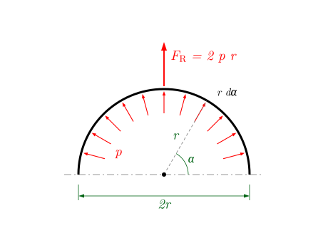

::: {.merke}
**Worum geht es?** Bauteile schweben nicht frei im Raum, sie sind **gelagert**: auf Stützen, an Wänden,
an anderen Bauteilen. Die Lager halten das Bauteil fest, indem sie Kräfte und Momente übertragen.
In dieser Vorlesung lernen Sie, welche Lasten auf ein Bauteil wirken können, wie man Lager durch ihre
**Reaktionen** ersetzt und wie man diese mit den Gleichgewichtsbedingungen aus Woche 1 berechnet.

::: {.content-visible when-format="html"}
Tipp: Mit **Bild↓ / Bild↑** oder **→ / ←** springen Sie von Schritt zu Schritt; Taste **B** schaltet den Beamer-Modus.
:::
:::

## Arten der Kräfte

:::: {.scrolly svg="../grafiken/lager/kraftarten.svg"}

::: {.schritt zeige="art-1 art-1-last" zoom="0 0 420 260"}
### Einzelkraft

Eine Stütze steht auf einem Träger. Ihre Last verteilt sich über die kleine Fläche, mit der sie
aufsitzt: Eine Kraft, die genau in einem Punkt angreift, gibt es streng genommen nicht.
:::

::: {.schritt zeige="art-1 art-1-kraft" zoom="0 0 420 260"}
### Modell: Einzelkraft

Ist die Auflagefläche klein gegenüber dem Bauteil, ersetzen wir die Last durch eine **Einzelkraft** $F$,
die in einem Punkt angreift. Einheit: N.

Die Einzelkraft ist ein sehr gutes **Modell**.
:::

::: {.schritt zeige="art-2 art-2-last" zoom="0 0 420 260"}
### Linienlast

Eine **Linienlast** oder **Streckenlast** $q$ ist längs einer Linie verteilt. Einheit: N/m.

Beispiele: eine Wand, die auf einer Decke steht, oder das Eigengewicht eines Trägers.
Ist $q$ überall gleich groß, spricht man von einer **Gleichstreckenlast**.
:::

::: {.schritt zeige="art-2 art-2-kraft" zoom="0 0 420 260"}
### Ersatz: Resultierende der Linienlast

Für das Gleichgewicht des ganzen Trägers ersetzt man die Linienlast durch **eine** Einzelkraft: Bei konstantem
$q$ über die Länge $L$ ist $F_R = q\,L$, in der Mitte. Wie man $F_R$ allgemein berechnet, folgt unten bei den
Streckenlasten.
:::

::: {.schritt zeige="art-3 art-3-last" zoom="0 0 420 260"}
### Flächenlast

Eine **Flächenlast** $p$ ist über eine Fläche verteilt. Einheit: N/m² = Pa.

Beispiele: Schnee auf einem Dach, Wind auf einer Fassade, Wasserdruck auf eine Staumauer.
Für einen Träger, der einen Streifen der Breite $b$ trägt, wird daraus eine Linienlast $q = p\,b$.
:::

::: {.schritt zeige="art-3 art-3-kraft" zoom="0 0 420 260"}
### Ersatz: Resultierende der Flächenlast

Auch die Flächenlast lässt sich durch **eine** Einzelkraft ersetzen: Bei konstantem $p$ auf der Fläche $A$ ist
$F_R = p\,A$, angreifend im Flächenmittelpunkt.
:::

::: {.schritt zeige="art-4 art-4-last" zoom="0 0 420 260"}
### Volumenkraft

Eine **Volumenkraft** wirkt auf jedes Volumenelement des Körpers, zum Beispiel das Gewicht mit
$\rho\,g$ in N/m³ ($\rho$: Dichte).
:::

::: {.schritt zeige="art-4 art-4-kraft" zoom="0 0 420 260"}
### Ersatz: Gewichtskraft im Schwerpunkt

Am starren Körper ersetzt man sie durch **eine** Einzelkraft, die Gewichtskraft $G = m\,g$ im
**Schwerpunkt**.

$G$ ersetzt die verteilte Last vollständig: Beide dürfen nicht gleichzeitig angetragen werden.
:::

::: {.schritt zeige="uebersicht" zoom="0 300 840 520"}
### Vom Bauteil zum Modell

| Kraftart | Symbol | Einheit |
|:--|:-:|:-:|
| Einzelkraft | $F$ | N |
| Linienlast | $q$ | N/m |
| Flächenlast | $p$ | N/m² |
| Volumenkraft | $\rho g$ | N/m³ |

In der Statik der Stäbe und Balken rechnen wir fast nur mit **Einzelkräften** und **Linienlasten**.
Flächen- und Volumenkräfte werden vorher auf diese zurückgeführt.
:::

::::

## Lager

:::: {.scrolly svg="../grafiken/lager/lager.svg"}

::: {.schritt zeige="l-freiheitsgrade" zoom="0 0 420 250"}
### Drei Freiheitsgrade

Ein starrer Körper kann sich in der Ebene auf **drei** Arten bewegen: zwei Verschiebungen und eine
Drehung. Er hat drei **Freiheitsgrade**.

Lager nehmen ihm Freiheitsgrade. Für jede verhinderte Bewegung überträgt das Lager eine **Reaktion**:
eine Kraft gegen eine Verschiebung, ein Moment gegen eine Drehung.
:::

::: {.schritt zeige="l-los" zoom="0 0 420 250"}
### Loslager

Das **Loslager** verhindert nur die Verschiebung senkrecht zur Bahn. Längs der Bahn kann das Bauteil
rollen, drehen kann es sich auch.

Es überträgt **eine** Kraft senkrecht zur Bahn: einwertig.

::: {.vertiefung titel="Anschaulich: auf dem Skateboard"}
Stellen Sie sich auf ein Skateboard. Waagerecht rollen Sie frei weg: Diese Bewegung wird nicht verhindert,
also entsteht dort auch **keine** Gegenkraft. Nach unten dagegen hält Sie der Boden. Er verhindert die
Bewegung und drückt mit einer Kraft gegen Ihr Gewicht. Wo ein Lager eine Bewegung verhindert, entsteht
eine Reaktion, wo es sie zulässt, nicht.
:::
:::

::: {.schritt zeige="l-fest" zoom="0 0 420 250"}
### Festlager

Das **Festlager** verhindert beide Verschiebungen, die Drehung bleibt frei (Gelenk).

Es überträgt eine Kraft in beliebiger Richtung, zerlegt in **zwei** Komponenten $F_{AH}$ und
$F_{AV}$: zweiwertig.
:::

::: {.schritt zeige="l-einsp" zoom="0 0 420 250"}
### Einspannung

Die **Einspannung** verhindert alle drei Bewegungen.

Sie überträgt **zwei** Kraftkomponenten und **ein Moment** $M_A$: dreiwertig. Beispiele: ein Balkon,
eine Stütze in einem Fundament.
:::

::: {.schritt zeige="l-gelenk" zoom="0 0 420 250"}
### Gelenk

Ein **Gelenk** verbindet zwei Bauteile. Es überträgt Kräfte, aber **kein Moment**: Die Teile können sich
gegeneinander verdrehen.

Schneidet man das Gelenk auf, wirken auf beide Teile die **Gelenkkräfte** $G_H$, $G_V$, nach actio = reactio
entgegengesetzt.
:::

::: {.schritt zeige="l-pendel" zoom="0 0 420 250"}
### Pendelstütze

Eine **Pendelstütze** ist ein Stab mit Gelenken an beiden Enden, der selbst unbelastet ist.
Sie kann nur eine Kraft **in Stabrichtung** übertragen, Zug oder Druck: einwertig.

Die Richtung der Lagerkraft ist also bekannt, unbekannt ist nur ihr Betrag $S$.

::: {.vertiefung titel="Ausführlicher: Warum nur in Stabrichtung?"}
Am freigeschnittenen Stab greifen nur zwei Kräfte an, eine in jedem Gelenk. Nach dem 3. Axiom sind zwei
Kräfte nur dann im Gleichgewicht, wenn sie auf **derselben Wirkungslinie** liegen. Diese Wirkungslinie
geht durch beide Gelenke, sie ist die Stabachse.
:::
:::

::: {.schritt zeige="uebersicht" zoom="0 280 1260 500"}
### Lager im Überblick

| Lager | Wertigkeit | Reaktionen |
|:--|:-:|:--|
| Loslager | 1 | Kraft senkrecht zur Bahn |
| Festlager | 2 | $F_H$, $F_V$ |
| Einspannung | 3 | $F_H$, $F_V$, $M$ |
| Gelenk (zwischen Teilen) | 2 | $G_H$, $G_V$ |
| Pendelstütze | 1 | Kraft in Stabrichtung |

Die Richtung einer unbekannten Lagerkraft wird **willkürlich** angenommen. Ein negatives Ergebnis heißt:
Sie wirkt andersherum.
:::

::::

## Statische Bestimmtheit

:::: {.scrolly svg="../grafiken/lager/bestimmtheit.svg"}

::: {.schritt zeige="b-bestimmt" zoom="0 0 440 230"}
### Das Abzählkriterium

Jeder freigeschnittene Körper liefert **drei** Gleichgewichtsbedingungen. Damit alle Reaktionen berechenbar
sind, muss es genauso viele Unbekannte geben:

$$
3n = a + z
$$

- $n$: Anzahl der Körper
- $a$: Anzahl der Lagerreaktionen (alle Lager zusammen)
- $z$: Anzahl der Gelenkreaktionen (Zwischenreaktionen in Gelenken und Pendelstützen)

Fest- und Loslager: ein Körper, Festlager zwei und Loslager eine Reaktion, kein Gelenk.

$$
\begin{aligned}
3n &= a + z\\
3 \cdot 1 &= 3 + 0\\
3 &= 3
\end{aligned}
$$

**Statisch bestimmt.**
:::

::: {.schritt zeige="b-zwang" zoom="0 0 440 230"}
### Warum statisch bestimmt lagern?

Ein statisch bestimmt gelagerter Träger kann sich **zwängungsfrei** verformen. Dehnt er sich bei Erwärmung
um $\Delta l$, rollt das Loslager einfach mit.

Zwischen zwei Festlagern dagegen würde die Dehnung behindert, es entstünden zusätzliche Kräfte und
Spannungen. Deshalb haben Brücken auf einer Seite ein Loslager oder Dehnfugen.
:::

::: {.schritt zeige="b-unbestimmt" zoom="0 0 440 230"}
### Statisch unbestimmt

Zwei Festlager liefern **vier** Unbekannte, aber nur drei Gleichungen:

$$
\begin{aligned}
3n &= a + z\\
3 \cdot 1 &= 4 + 0\\
3 &< 4
\end{aligned}
$$

**Statisch unbestimmt.** Mehr Unbekannte als Gleichungen. Die Lagerkräfte lassen sich mit der Statik allein nicht
berechnen, man braucht zusätzlich die Verformung (Woche 7).
:::

::: {.schritt zeige="b-beweglich" zoom="0 0 440 230"}
### Beweglich

Zwei Loslager liefern nur **zwei** Unbekannte:

$$
\begin{aligned}
3n &= a + z\\
3 \cdot 1 &= 2 + 0\\
3 &> 2
\end{aligned}
$$

**Beweglich** (kinematisch). Der Träger kann waagerecht wegrollen. Das ist kein Tragwerk,
sondern ein Mechanismus, ein Fall für die Dynamik.
:::

::: {.schritt zeige="b-ausnahme" zoom="0 0 440 230"}
### Vorsicht: notwendig, aber nicht hinreichend

Drei Loslager:

$$
\begin{aligned}
3n &= a + z\\
3 \cdot 1 &= 3 + 0\\
3 &= 3
\end{aligned}
$$

Nach der Zählung statisch bestimmt, **tatsächlich aber beweglich**: Der Träger kann waagerecht wegrollen.
Alle drei Lagerkräfte sind parallel, keine kann eine waagerechte Kraft aufnehmen.

Das Abzählkriterium ist also **notwendig, aber nicht hinreichend**. Prüfen Sie immer zusätzlich, ob die
Lager die Bewegung wirklich verhindern: Die Lagerkräfte dürfen nicht alle parallel sein und nicht alle
durch einen Punkt gehen.
:::

::::

## Lagerreaktionen berechnen

:::: {.scrolly svg="../grafiken/lager/einfeldtraeger.svg"}

::: {.schritt zeige="system" zoom="40 30 580 230"}
### Beispiel: Einfeldträger mit Kragarm

Ein Träger ist in $A$ fest und in $B$ los gelagert. Er trägt $F_1 = F$ in der Mitte und $F_2 = 2F$ am Ende
des Kragarms.

**Gesucht:** die Lagerreaktionen

**Abzählen:** $n = 1$ Körper, $a = 3$ Lagerreaktionen, $z = 0$ Gelenkreaktionen.

$$
\begin{aligned}
3n &= a + z\\
3 \cdot 1 &= 3 + 0\\
3 &= 3
\end{aligned}
$$

**Statisch bestimmt.**
:::

::: {.schritt zeige="system freikoerper" dimmen="system" zoom="20 30 620 390"}
### ① Freikörperbild

Die Lager werden durch ihre Reaktionen ersetzt: in $A$ die Komponenten $F_{AH}$ und $F_{AV}$, in $B$ die
Kraft $F_B$. Alle unbekannten Kräfte zeichnen wir in **positive** Koordinatenrichtung.
:::

::: {.schritt zeige="freikoerper" zoom="20 230 620 190"}
### ② Gleichgewicht

Die drei Gleichgewichtsbedingungen schreiben wir immer in derselben Reihenfolge auf: waagerecht,
senkrecht, Momente.

$$
\begin{aligned}
&\rightarrow: && F_{AH} = 0 &&\qquad(1)\\[2pt]
&\uparrow: && F_{AV} + F_B - F - 2F = 0 &&\qquad(2)\\[2pt]
&\curvearrowleft A: && -F\,\tfrac{L}{2} + F_B\,L - 2F\cdot 1{,}1\,L = 0 &&\qquad(3)
\end{aligned}
$$

Aufgelöst wird mit der Gleichung, die nur **eine** Unbekannte enthält: In (3) fallen $F_{AH}$ und $F_{AV}$
heraus.

$$
\begin{aligned}
&\text{aus (3):} && F_B = \frac{0{,}5\,F L + 2{,}2\,F L}{L} = 2{,}7\,F\\[2pt]
&\text{aus (1):} && F_{AH} = 0\\[2pt]
&\text{$F_B$ eingesetzt in (2):} && F_{AV} = 3F - F_B = 0{,}3\,F
\end{aligned}
$$
:::

::: {.schritt zeige="freikoerper" zoom="20 230 620 190"}
### ③ Kontrolle

Eine Gleichung, die man noch nicht benutzt hat, muss ebenfalls erfüllt sein, zum Beispiel die Momente um $B$:

$$
\begin{aligned}
&\curvearrowleft B: && -F_{AV}\,L + F\,\tfrac{L}{2} - 2F\cdot 0{,}1\,L\\
& && = (-0{,}3 + 0{,}5 - 0{,}2)\,F L = 0 \;\checkmark
\end{aligned}
$$

Schnelle Plausibilitätsprüfung: Die Lagerkräfte zusammen ($0{,}3F + 2{,}7F = 3F$) tragen genau die
Lasten ($F + 2F = 3F$).

Lager $B$ trägt fast alles: Der Kragarm „drückt“ es nach unten und hebt Lager $A$ beinahe ab.
:::

::::

:::: {.scrolly svg="../grafiken/lager/kragtraeger.svg"}

::: {.schritt zeige="system" zoom="40 30 560 230"}
### Beispiel: Eingespannter Balken

Derselbe Träger, jetzt aber links **eingespannt** und ohne Lager $B$. $F_2 = 2F$ greift am freien Ende an.

**Abzählen:** $n = 1$ Körper, $a = 3$ Lagerreaktionen, $z = 0$ Gelenkreaktionen.

$$
\begin{aligned}
3n &= a + z\\
3 \cdot 1 &= 3 + 0\\
3 &= 3
\end{aligned}
$$

**Statisch bestimmt.**
:::

::: {.schritt zeige="freikoerper" zoom="20 210 580 190"}
### Gleichgewicht

Die Einspannung liefert $F_{AH}$, $F_{AV}$ und das **Einspannmoment** $M_A$.

$$
\begin{aligned}
&\rightarrow: && F_{AH} = 0 &&\qquad(1)\\[2pt]
&\uparrow: && F_{AV} - F - 2F = 0 &&\qquad(2)\\[2pt]
&\curvearrowleft A: && M_A - F\,\tfrac{L}{2} - 2F\,L = 0 &&\qquad(3)
\end{aligned}
$$

Hier enthält jede Gleichung nur eine Unbekannte:

$$
\begin{aligned}
&\text{aus (1):} && F_{AH} = 0\\[2pt]
&\text{aus (2):} && F_{AV} = 3F\\[2pt]
&\text{aus (3):} && M_A = 2{,}5\,F L
\end{aligned}
$$

Die Einspannung muss die ganze Last tragen **und** das Kippmoment aufnehmen.

::: {.vertiefung titel="Häufige Frage: Muss man das Einspannmoment noch mit einem Hebelarm multiplizieren?"}
Nein. $M_A$ ist bereits ein **Moment** (in N m), es kommt so, wie es ist, in die Momentengleichung. Nur
Kräfte brauchen einen Hebelarm. Ebenso ein gegebenes äußeres Moment, etwa ein Moment $M$ irgendwo am
Balken: Es erscheint nur in der Momentengleichung, nicht in den Kraftgleichungen, und es ist egal, wo es
angreift (ein Moment ist frei verschieblich).
:::

::: {.vertiefung titel="Ausführlicher: Andere Richtungsannahme, gleiches Ergebnis"}
Zeichnet man $F_{AV}$ nach unten und wählt den Drehsinn andersherum, ergibt sich $F_{AV} = -3F$ und
$M_A = -2{,}5\,FL$. Das ist **dasselbe** Ergebnis: Das Minuszeichen sagt nur, dass die Kraft entgegen der
angenommenen Richtung wirkt.
:::
:::

::::

::: {.merke}
**Rechenschema für Lagerreaktionen**

1. **Abzählen:** $3n = a + z$? Lager verhindern die Bewegung wirklich?
2. **Freikörperbild:** Lager durch Reaktionen ersetzen, und zwar **vollständig** (Festlager zwei Kräfte,
   Einspannung zwei Kräfte und ein Moment). Die Richtung ist beliebig, das Vorzeichen zeigt am Ende die
   wahre Richtung; am einfachsten in positive Koordinatenrichtung zeichnen.
3. **Gleichgewicht** immer in derselben Reihenfolge aufschreiben: $\rightarrow$, $\uparrow$, $\curvearrowleft$,
   und nummerieren: (1), (2), (3).
   Für die Momente einen Punkt wählen, in dem möglichst viele Unbekannte angreifen.
4. **Auflösen**, beginnend mit der Gleichung mit nur einer Unbekannten, und jeden Schritt benennen:
   „aus (3): …“, „$F_B$ eingesetzt in (2): …“. Vorzeichen deuten.
5. **Kontrolle** mit einer noch nicht benutzten Gleichung.
:::

## Streckenlasten

:::: {.scrolly svg="../grafiken/lager/streckenlasten.svg"}

::: {.schritt zeige="allgemein" zoom="0 0 560 300"}
### Streckenlast

Eine Streckenlast $q(x)$ gibt an, wie viel Kraft pro Länge an der Stelle $x$ wirkt.
Auf ein kleines Stück $\mathrm dx$ im Abstand $x$ vom Ursprung entfällt die Kraft

$$
\mathrm dF = q(x)\,\mathrm dx
$$

Ihr Moment um den Ursprung ist

$$
\mathrm dM = x\,\mathrm dF = x\,q(x)\,\mathrm dx
$$
:::

::: {.schritt zeige="ersatz" zoom="0 0 560 300"}
### Ersatz durch eine Einzelkraft

Für das Gleichgewicht ersetzen wir die Streckenlast durch eine **Resultierende** $F_R$ mit derselben Kraft-
und Momentenwirkung. Die Kräfte $\mathrm dF$ aller Stücke über die Länge $L$ summieren sich zu

$$
F_R = \int_0^L \mathrm dF = \int_0^L q(x)\,\mathrm dx
$$

Die Teilmomente $x\,q(x)\,\mathrm dx$ müssen zusammen dasselbe Moment ergeben wie $F_R$ im Abstand $x_R$:

$$
F_R\,x_R = \int_0^L x\,q(x)\,\mathrm dx
\quad\Rightarrow\quad
x_R = \frac{1}{F_R}\int_0^L x\,q(x)\,\mathrm dx
$$

$F_R$ ist die **Fläche** unter der Lastkurve, $x_R$ die Lage ihres **Schwerpunkts**.
:::

::: {.schritt zeige="rechteck rechteck-last" zoom="0 0 560 300"}
### Rechtecklast

Die Last $q$ ist über die ganze Länge $L$ konstant.
:::

::: {.schritt zeige="rechteck rechteck-ersatz" zoom="0 0 560 300"}
### Resultierende der Rechtecklast

Bei konstanter Last $q$ über die Länge $L$:

$$
F_R = q\,L, \qquad x_R = \frac{L}{2}
$$

Die Resultierende greift in der **Mitte** an.
:::

::: {.schritt zeige="dreieck dreieck-last" zoom="0 0 560 300"}
### Dreieckslast

Die Last steigt linear von $0$ auf $q_0$ an:

$$
q(x) = q_0\,\frac{x}{L}
$$
:::

::: {.schritt zeige="dreieck dreieck-ersatz" zoom="0 0 560 300"}
### Resultierende der Dreieckslast

Für diese Last gilt:

$$
F_R = \tfrac12\,q_0\,L, \qquad x_R = \tfrac23\,L
$$

Die Resultierende liegt im **Drittelpunkt** auf der Seite der größeren Last.

::: {.vertiefung titel="Ausführlicher: Herleitung für die Dreieckslast"}
$$
\begin{aligned}
F_R &= \int_0^L \frac{q_0}{L}\,x\,\mathrm dx = \frac{q_0}{L}\,\frac{L^2}{2} = \frac{q_0 L}{2}\\[2pt]
\int_0^L q\,x\,\mathrm dx &= \frac{q_0}{L}\,\frac{L^3}{3} = \frac{q_0 L^2}{3}
\quad\Rightarrow\quad x_R = \frac{q_0L^2/3}{q_0L/2} = \frac23\,L
\end{aligned}
$$

Zusammengesetzte Lasten (Trapez, mehrere Abschnitte) zerlegt man in Rechtecke und Dreiecke und ersetzt
jedes Teil einzeln.
:::
:::

::::

::: {.merke}
**Wichtig:** Eine Streckenlast darf man für das **Gleichgewicht eines ganzen Körpers** durch ihre Resultierende
ersetzen. Schneidet man den Körper später auf, um innere Kräfte zu berechnen (Woche 3), muss man **erst
schneiden** und dann nur den Lastanteil am Teilkörper ersetzen.
:::

::: {.vertiefung titel="Ergänzung: Druck auf gekrümmte Flächen"}
{width=60%}

Wirkt ein konstanter Druck $p$ auf einen Halbkreisbogen mit dem Radius $r$, heben sich die waagerechten
Anteile auf. Die senkrechte Resultierende ist

$$
F_R = \int_0^{\pi} p\,\sin\alpha\;r\,\mathrm d\alpha = 2\,p\,r
$$

Das ist genau der Druck mal der **Projektionslänge** $2r$. Diese Regel gilt allgemein: Die Kraft eines
konstanten Drucks auf eine gekrümmte Fläche in einer Richtung ist gleich Druck mal Projektion der Fläche
senkrecht zu dieser Richtung.
:::

## Systeme mit Gelenk

:::: {.scrolly svg="../grafiken/lager/kfz-anhaenger.svg"}

::: {.schritt zeige="ansicht" zoom="20 40 620 170"}
### Beispiel: Pkw mit Anhänger

Ein Pkw (1500 kg, mit Fahrer 1600 kg) zieht einen einachsigen Anhänger. Die Ladung des Anhängers
(2500 N) ist gleichmäßig über seine Länge verteilt. Die Handbremse ist angezogen.

**Gesucht:** die Achslasten und die Kraft in der Kupplung
:::

::: {.schritt zeige="ansicht modell" dimmen="ansicht" zoom="20 40 620 370"}
### Modell

- Pkw und Anhänger sind zwei Balken, verbunden durch das **Gelenk** $G$ (Anhängerkupplung).
- Vorderachse $A$: Loslager. Hinterachse $B$ (gebremst): Festlager. Anhängerachse $C$: Loslager.
- Gewicht des Pkw $F_K = 15{,}7$ kN, Ladung $q_0 = 1250$ N/m auf $L_A = 2$ m.

**Abzählen:** $n = 2$ Körper, $a = 4$ Lagerreaktionen ($A$ und $C$ je eine, $B$ zwei),
$z = 2$ Gelenkreaktionen ($G_H$, $G_V$).

$$
\begin{aligned}
3n &= a + z\\
3 \cdot 2 &= 4 + 2\\
6 &= 6
\end{aligned}
$$

**Statisch bestimmt.**
:::

::: {.schritt zeige="modell freischnitt" dimmen="modell" zoom="20 230 690 350"}
### Am Gelenk trennen

Wir schneiden am Gelenk. Auf beide Teile wirken die Gelenkkräfte $G_H$, $G_V$, **entgegengesetzt**
(actio = reactio).

Wir beginnen mit dem Teil, an dem nur **drei** Unbekannte angreifen: dem Anhänger ($G_H$, $G_V$, $F_C$).
:::

::: {.schritt zeige="freischnitt" zoom="20 380 690 200"}
### ① Anhänger

Resultierende der Ladung: $F_q = q_0 L_A = 2500$ N, 1,0 m hinter der Kupplung.

$$
\begin{aligned}
&\rightarrow: && G_H = 0 &&\qquad(1)\\[2pt]
&\uparrow: && G_V + F_C - F_q = 0 &&\qquad(2)\\[2pt]
&\curvearrowleft C: && -G_V \cdot 1{,}2\ \text{m} + F_q \cdot 0{,}2\ \text{m} = 0 &&\qquad(3)
\end{aligned}
$$

$$
\begin{aligned}
&\text{aus (3):} && G_V = \frac{F_q\cdot 0{,}2\ \text{m}}{1{,}2\ \text{m}} = 417\ \text{N}\\[2pt]
&\text{aus (1):} && G_H = 0\\[2pt]
&\text{$G_V$ eingesetzt in (2):} && F_C = F_q - G_V = 2083\ \text{N}
\end{aligned}
$$

Die Achse sitzt hinter der Lastmitte: Ein Teil der Ladung stützt sich auf die Kupplung, die **Stützlast** $G_V$.
:::

::: {.schritt zeige="freischnitt" zoom="20 380 690 200"}
### ② Pkw

Auf den Pkw drückt die Stützlast $G_V = 417$ N nach unten.

$$
\begin{aligned}
&\rightarrow: && F_{BH} = 0 &&\qquad(4)\\[2pt]
&\uparrow: && F_A + F_{BV} - F_K - G_V = 0 &&\qquad(5)\\[2pt]
&\curvearrowleft B: && -F_A\cdot 2{,}4 + F_K\cdot 1{,}6 - G_V\cdot 0{,}8 = 0 &&\qquad(6)
\end{aligned}
$$

Die Nummern laufen weiter, damit sie eindeutig bleiben.

$$
\begin{aligned}
&\text{aus (6):} && F_A = \frac{F_K\cdot 1{,}6 - G_V\cdot 0{,}8}{2{,}4} = 10{,}33\ \text{kN}\\[2pt]
&\text{aus (4):} && F_{BH} = 0\\[2pt]
&\text{$F_A$ eingesetzt in (5):} && F_{BV} = F_K + G_V - F_A = 5{,}79\ \text{kN}
\end{aligned}
$$

Ohne Anhänger wären es $10{,}46$ kN und $5{,}23$ kN: Die Stützlast **entlastet die Vorderachse** und
belastet die Hinterachse stärker, wie ein Hebel über die Hinterachse.
:::

::::

:::: {.scrolly svg="../grafiken/lager/lkw-deichsel.svg"}

::: {.schritt zeige="ansicht" zoom="0 60 860 160"}
### Variante: Lkw mit Deichselanhänger

Ein Lkw zieht einen **zweiachsigen** Anhänger. Lkw und Anhänger sind über eine **Deichsel** verbunden, die
an beiden Enden gelenkig angeschlossen ist.

Was ändert sich gegenüber dem einachsigen Anhänger?
:::

::: {.schritt zeige="ansicht deichsel" dimmen="ansicht" zoom="0 60 860 360"}
### Die Deichsel ist eine Pendelstütze

Die Deichsel ist ein Stab mit zwei Gelenken: eine **Pendelstütze**. Sie überträgt nur eine Kraft $S$
**in Deichselrichtung**.

Bei waagerechter Deichsel gibt es deshalb **keine Stützlast**: Der Anhänger trägt sich allein auf seinen
zwei Achsen $C$ und $D$, der Lkw spürt nur die Zug- oder Bremskraft $S$.

**Abzählen:** $n = 2$ Körper, $a = 5$ Lagerreaktionen (Lkw drei, Anhänger zwei),
$z = 1$ Gelenkreaktion (Stabkraft $S$ der Pendelstütze).

$$
\begin{aligned}
3n &= a + z\\
3 \cdot 2 &= 5 + 1\\
6 &= 6
\end{aligned}
$$

**Statisch bestimmt.**

::: {.vertiefung titel="Ausführlicher: Und beim Bremsen?"}
Beim Anfahren oder Bremsen ist $S \neq 0$. Greift $S$ höher oder tiefer an als die Schwerpunkte und
Radaufstandspunkte, erzeugt sie Momente, die die Achslasten verschieben. Das ist ein Thema der Dynamik.
Im Stand mit waagerechter Deichsel bleiben Lkw und Anhänger statisch entkoppelt.
:::
:::

::::

## Zusammenfassung

:::: {.scrolly svg="../grafiken/lager/zusammenfassung-lager.svg"}

::: {.schritt zeige="k-arten k-lager" zoom="0 0 950 480"}
### Lasten und Lager

Lasten wirken als **Einzelkraft**, **Linien-**, **Flächen-** oder **Volumenkraft**. Lager nehmen dem Körper
Freiheitsgrade und übertragen dafür **Reaktionen**: Loslager 1, Festlager 2, Einspannung 3.
:::

::: {.schritt zeige="k-arten k-lager k-bestimmt" dimmen="k-arten k-lager" zoom="0 0 950 480"}
### Statische Bestimmtheit

$3n = a + z$ ist **notwendig**, aber nicht hinreichend. Die Lager müssen jede Bewegung wirklich verhindern.
:::

::: {.schritt zeige="k-arten k-lager k-bestimmt k-rechnen" dimmen="k-arten k-lager k-bestimmt" zoom="0 0 950 480"}
### Lagerreaktionen

Freikörperbild, drei Gleichgewichtsbedingungen, Momentenbilanz um einen geschickten Punkt, Kontrolle.
:::

::: {.schritt zeige="k-arten k-lager k-bestimmt k-rechnen k-strecke k-gelenk" dimmen="k-arten k-lager k-bestimmt k-rechnen" zoom="0 0 950 480"}
### Streckenlasten und Gelenke

Streckenlasten ersetzt man für das Gleichgewicht durch ihre **Resultierende** im Flächenschwerpunkt.
Mehrteilige Systeme trennt man an den **Gelenken** und beginnt mit dem Teil mit drei Unbekannten.
:::

::: {.schritt zeige="k-arten k-lager k-bestimmt k-rechnen k-strecke k-gelenk" zoom="0 0 950 480"}
### Das Wichtigste auf einen Blick

Mit den Lagerreaktionen kennen wir alle **äußeren** Kräfte eines Tragwerks. In Woche 3 schneiden wir das
Tragwerk selbst auf und bestimmen die **inneren** Kräfte, die Schnittgrößen.

**Weiter:** [Aufgaben zu Lager und Lagerreaktionen](../seminar/02-lager.qmd)
:::

::::

### Zum Nachschlagen

::: {.merke}
| Thema | Formel | Bemerkung |
|:--|:--|:--|
| Linienlast aus Flächenlast | $q = p\,b$ | Streifenbreite $b$ |
| Abzählkriterium | $3n = a + z$ | notwendig, nicht hinreichend |
| Wertigkeit | Loslager 1, Festlager 2, Einspannung 3 | Gelenk: 2 Zwischenreaktionen |
| Gleichgewicht | $\sum F_x = 0$, $\sum F_y = 0$, $\sum M^{(P)} = 0$ | je Körper |
| Streckenlast | $F_R = \int q\,\mathrm dx$, $x_R = \frac{1}{F_R}\int q\,x\,\mathrm dx$ | Fläche, Schwerpunkt |
| Rechtecklast | $F_R = qL$ bei $L/2$ | |
| Dreieckslast | $F_R = \tfrac12 q_0 L$ bei $\tfrac23 L$ | vom Nullpunkt der Last |
:::

::: {.small .text-muted}
Literatur: Gross/Hauger/Schröder/Wall, Technische Mechanik 1, Kap. 5 ·
Dankert/Dankert, Technische Mechanik, Kap. 5–6
:::
